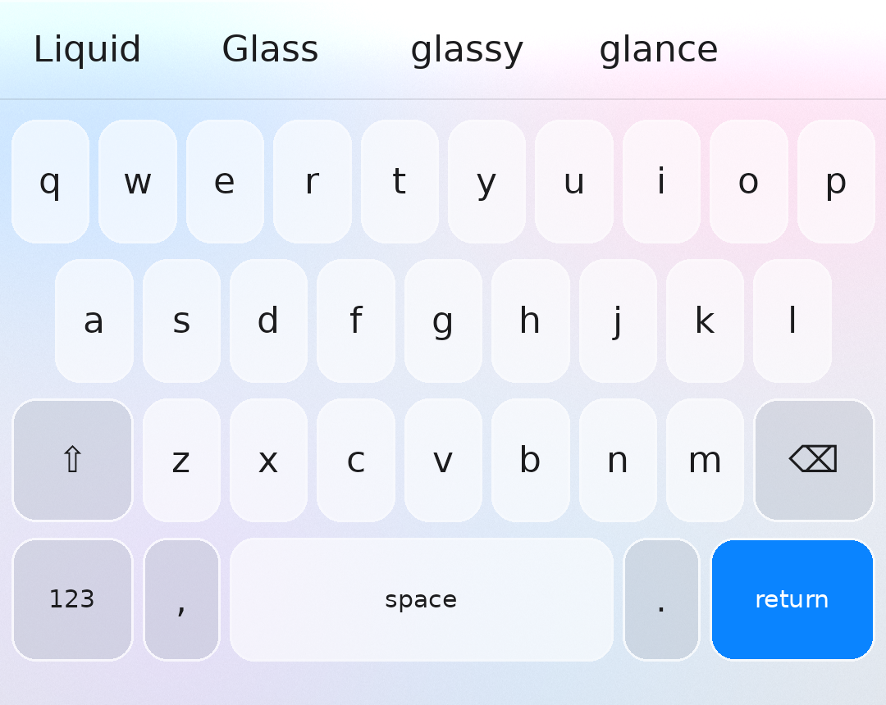
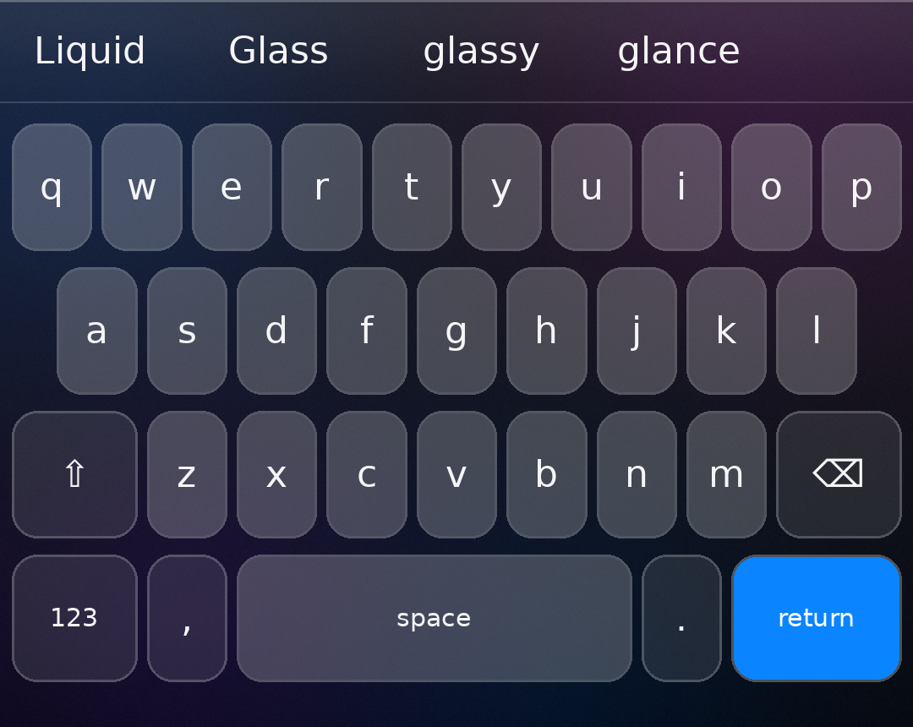

# Fcitx5 for Android · 液态玻璃主题

仿 iOS 26「液态玻璃(Liquid Glass)」风格的 [Fcitx5 for Android](https://github.com/fcitx5-android/fcitx5-android) 键盘主题,提供浅色 / 深色两款,也可以用自己的壁纸生成。

| 浅色 LiquidGlassLight | 深色 LiquidGlassDark |
| --- | --- |
|  |  |

> 预览图由脚本近似绘制,实际效果以手机上为准。

## 安装

1. 下载 `dist/` 里的 `LiquidGlassLight.zip` 和/或 `LiquidGlassDark.zip`。
2. 打开 Fcitx5 → **主题** → 右上角 **+** → **导入**,选中 zip。
3. 在 **主题** 页面把下面几项调成这样(玻璃效果主要靠它们):

| 设置项 | 推荐值 | 作用 |
| --- | --- | --- |
| 按键边框 | 开 | 按键独立成块,候选栏透明 |
| 按键边框描边 | 开 | 用高光色画出玻璃的亮边 |
| 按键圆角半径 | 10–14 dp | iOS 26 的大圆角 |
| 按键水平间距 | 3 dp | |
| 按键垂直间距 | 6–7 dp | |
| 按键涟漪效果 | 关 | iOS 风格的按下效果是整键高亮 |
| 跟随系统深色模式 | 开,浅色选 `LiquidGlassLight`,深色选 `LiquidGlassDark` | |

## 用自己的壁纸生成

把桌面壁纸做成毛玻璃背景,键盘看起来就像「透出」桌面:

```bash
pip install pillow numpy
```

```bash
python3 tools/build_theme.py --wallpaper ~/wallpaper.jpg --name MyGlass
```

生成 `dist/MyGlassLight.zip` 和 `dist/MyGlassDark.zip`,导入方法同上。不带参数运行会重新生成内置的两款主题。

## 原理与限制

Fcitx5 for Android 的自定义主题只支持「一张背景图 + 各部件颜色」,没有实时模糊、折射这类着色器效果,所以这里这样模拟液态玻璃:

- **背景**:对彩色光斑(或你的壁纸)做高斯模糊、提高饱和度、蒙一层白/黑,顶部加一道镜面高光和亮边,也就是 iOS 毛玻璃材质的做法;
- **按键**:用半透明白色叠在背景上,背景颜色会「透」过按键;
- **玻璃边缘**:把 `keyShadowColor` 设成半透明白色,配合「按键边框描边」,画出玻璃的折射亮边;
- **回车键**:iOS 系统蓝 `#0A84FF`。

背景是静态图片,不会随键盘后面的内容实时变化。想要实时模糊,见下面的源码补丁。

## 源码补丁:实时模糊 + 剪贴板硬件加密

`patches/` 里是针对上游 fcitx5-android(固定在 `eb5b502`)的两个补丁,需要自己编译安装包:

```bash
tools/apply_patches.sh            # 克隆上游、检出固定提交、应用补丁
cd fcitx5-android && ./gradlew assembleRelease
```

> ⚠️ **这两个补丁还没有在真机上跑过,也没有完整编译过**(开发环境里装不了 Android SDK)。已做的验证:补丁能干净地应用到上游固定提交;`GlassBackdrop` 和 `ClipboardCrypto` 用 Android 14 框架 jar 做过类型检查;加解密/哈希的往返、篡改检测在 JVM 上测过。Keystore、Room 迁移、窗口模糊都只能在真机上验证,首次编译还会生成 `app/schemas/.../ClipboardDatabase/5.json`,请一并提交。

### 0001 · 实时玻璃模糊

主题设置里新增「实时玻璃模糊」开关和「玻璃模糊半径」(Android 12+,默认关)。

- IME 窗口本身是全屏的(按键气泡要画在键盘外面),直接用 `Window.setBackgroundBlurRadius` 会把整个屏幕都模糊掉。所以改为在键盘正下方放一个**不可触摸的子窗口**(`TYPE_APPLICATION_MEDIA`,层级在 IME 窗口之下),只对它设置 `blurBehindRadius`,按键仍然画在模糊层之上。
- 系统关闭跨窗口模糊(省电模式、厂商限制、低端设备)时自动回退到主题自带的静态毛玻璃背景。
- 建议同时开启「按键边框」,并使用本仓库的 LiquidGlass 主题(半透明按键)。
- 模糊的是键盘后面的内容。大多数应用在键盘弹出时会把内容整体顶上去,键盘后面就只剩窗口底色,这时效果不明显;内容绘制到键盘后面的应用(边到边布局、`adjustNothing` 等)效果最好。

### 0002 · 剪贴板加密

- 剪贴板文本以 **AES-256-GCM** 密文存进数据库。
- 数据密钥由 **Android Keystore 里不可导出的主密钥**(有 StrongBox 就用 StrongBox,否则 TEE)包裹后存放在 no-backup 目录;主密钥设置了「仅解锁状态可用」。
- 去重不再比较明文,改用带密钥的 HMAC-SHA256。
- 数据库升级到 v5;旧版本留下的明文记录会在启动时自动加密。
- 密钥丢失(从备份恢复到新设备、移除锁屏等)后,旧密文无法恢复,会被清掉。
- 取不到密钥时(例如设备锁定)新复制的内容只保留在内存里,**不会明文落盘**。

没有加密的部分:时间戳、置顶状态、「敏感」标记和文本长度(从密文长度能看出来);输入法自己的词库/用户词频/快捷短语由 fcitx 原生代码读写,补丁没有处理。解封后的数据密钥在输入法进程运行期间存在于内存里,这是为了让滚动剪贴板列表不卡(每条都走 StrongBox 要几十毫秒)而做的取舍。

## 文件说明

```
tools/build_theme.py   主题生成脚本(配色、背景、打包、预览图)
tools/apply_patches.sh 克隆上游并应用源码补丁
patches/*.patch        实时模糊、剪贴板加密两个源码补丁
dist/*.zip             可直接导入的主题包
preview/*.png          预览图
```

主题 JSON 格式参照 fcitx5-android 源码中的 `Theme.Custom` / `CustomThemeSerializer`(版本 2.1)。
